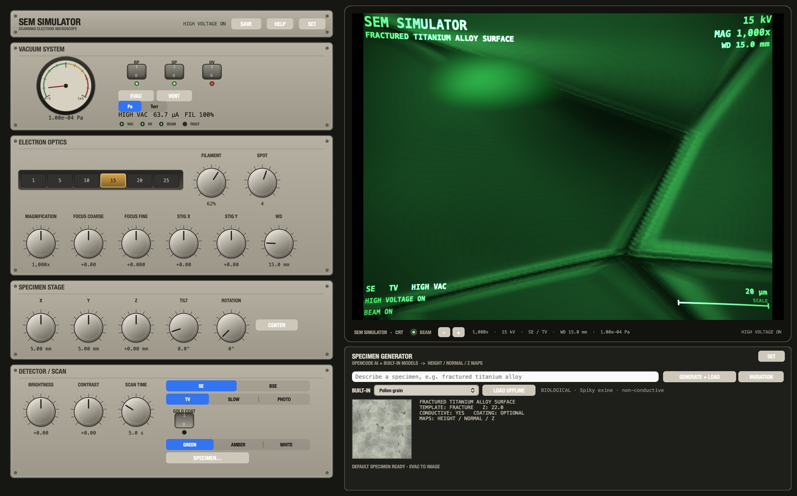

# SEM Simulator

A brand-free, late-1980s-style scanning electron microscope console simulator for macOS. It is a complete original simulation: no commercial SEM manufacturer, model name, logo, copied panel text, or trade dress is used.

The app is written entirely in Objective-C with AppKit and Metal. It has a procedural specimen generator, vacuum and electron-optics physics, a curved CRT renderer, and a localhost control API that OpenCode can drive through MCP.



## Features

- Curved CRT with green, amber, and white phosphor modes.
- Scanlines, persistence, glass glare, barrel distortion, and a scan sweep.
- TV, slow, and photo scan modes.
- Vacuum system with rotary pump, diffusion pump warm-up, pressure gauge, and interlocks.
- Automatic EVAC → high-vacuum → HV sequence after loading a specimen, with live stage-by-stage status.
- High voltage, filament, spot, focus, stigmator, working distance, magnification, and stage controls.
- SE and BSE detection, brightness/contrast, and scale bar.
- Charging on non-conductive samples; optional gold coating suppresses it.
- Persistent contamination marks after prolonged high-magnification scanning.
- Procedural specimen generator with height, normal, and Z maps.
- AI specimen drawer: describe a specimen, OpenCode returns a JSON recipe, and the maps are synthesized locally and loaded automatically.
- Built-in specimen catalog with 15 ready-to-use models in the Specimen menu, the generator drawer, and Settings, always available offline.
- Save any generated or loaded specimen to a `.semspecimen` file with its recipe, metadata, source prompt, seed, and preview image; load saved files back from disk and keep them in the offline list.
- No remote image service; OpenCode supplies only a structured specimen recipe.
- Live CRT status strip with magnification, voltage, detector, scan mode, working distance, and pressure.
- Pinch, scroll, keyboard, and menu zoom over the CRT.
- Built-in illustrated operating guide in Help.
- PNG micrograph export.
- Localhost JSON control API and OpenCode MCP integration.
- OpenCode URL, live model dropdown, optional password, connection test, and password-file loader.

## Requirements

- macOS 13 or newer.
- Xcode 27.2 (the project is built with XcodeGen).
- [XcodeGen](https://github.com/yonaskolb/XcodeGen).
- Node.js 18 or newer for the OpenCode MCP bridge.
- OpenCode V2 for the OpenCode integration.

The Metal toolchain is not required. Shader sources are bundled as resources and compiled at runtime with `newLibraryWithSource:`.

## Build and run

From the project root:

```sh
xcodegen generate
xcodebuild -project SEMSimulator.xcodeproj \
  -scheme SEMSimulator \
  -configuration Debug \
  CODE_SIGNING_ALLOWED=NO \
  build
```

The app is built at:

```text
~/Library/Developer/Xcode/DerivedData/SEMSimulator-*/Build/Products/Debug/SEM Simulator.app
```

Launch it with:

```sh
open "$HOME/Library/Developer/Xcode/DerivedData/SEMSimulator-"*/Build/Products/Debug/"SEM Simulator.app"
```

Or run the executable directly to see the control-API log:

```sh
"$HOME/Library/Developer/Xcode/DerivedData/SEMSimulator-"*/Build/Products/Debug/"SEM Simulator.app"/Contents/MacOS/"SEM Simulator"
```

The app starts with a default specimen already loaded. Press **EVAC**; the app runs the vacuum sequence and turns **HV** on automatically when high vacuum is reached.

### Application icon

The bundled icon is `SEMSimulator/Resources/AppIcon.icns`, referenced by `CFBundleIconFile` in `SEMSimulator/Info.plist`. Regenerate it after editing the artwork script with:

```sh
python3 scripts/make-app-icon.py
```

The script requires Pillow and writes both the `.icns` bundle icon and the `docs/app-icon.png` preview.

## Using the console

### Vacuum

1. Press **EVAC**, or load a specimen. The app runs the whole sequence automatically: roughing pump, diffusion-pump warm-up, and high vacuum.
2. The status line shows **EVAC: ROUGH VACUUM**, **DIFFUSION PUMP WARMING**, and **PUMPING DOWN** with live pressure.
3. When the pressure drops below `5e-3 Pa`, high voltage turns on automatically and the beam starts. The **HV** switch is interlocked until then.
4. Press **VENT** to vent. Venting forces high voltage off and cancels the automatic sequence.
5. If a fault occurs, press **RESET VACUUM FAULT** in Settings.

### Optics and stage

- **MAGNIFICATION**: 10x to 100,000x.
- **FOCUS COARSE / FINE**: defocus and fine focus.
- **STIG X / STIG Y**: astigmatism correction.
- **WD**: working distance.
- **SPOT**: probe current / spot size.
- **STAGE X / Y / Z / TILT / ROTATION**: specimen position.
- **SE / BSE**: detector mode.
- **TV / SLOW / PHOTO**: scan mode.
- **GOLD COAT**: apply or remove a conductive coating.

### Mouse, trackpad, and keyboard

- Pinch with two fingers over the CRT to zoom in or out. The **MAGNIFICATION** knob and live readouts follow the eased zoom.
- Option-scroll or Command-scroll over the CRT to zoom smoothly. Zoom input is coalesced and eased at the console refresh rate; every zoom frame refreshes the full CRT instead of updating one region slowly. A two-finger smart zoom resets to 1,000x.
- **Cmd-Plus** and **Cmd-Minus** zoom; **Cmd-0** resets magnification. The **View** menu contains the same commands, and the CRT status strip has `−` and `+` buttons.
- Drag a knob vertically to change it. Hold **Shift** while dragging for fine adjustment. Double-click a knob to restore its default value.
- The mouse wheel over a knob also adjusts it. Arrow keys work when a knob has focus.

### Offline specimen models (built-in and saved)

The app includes 15 ready-to-use models:

```text
Pollen grain · Diatom frustule · Fractured titanium · Microchip traces
Volcanic ash · Salt crystals · Carbon fiber · Tissue section
Bone trabeculae · Quartz sand · Rusted steel · Sponge spicule
Foraminifera · Butterfly wing · House fly
```

They are available in three places:

- **Specimen** menu: choose a model to load it immediately.
- **SPECIMEN GENERATOR** drawer: use the **OFFLINE** popup and press **LOAD OFFLINE**.
- **Settings > OFFLINE MODELS (BUILT-IN + SAVED)**: use the model dropdown and press **LOAD OFFLINE**.

To load one offline:

1. Open **Settings > OFFLINE MODELS (BUILT-IN + SAVED)**, or open the specimen drawer and use its **OFFLINE** popup.
2. Select one of the 15 built-in models. The detail line shows its category and description.
3. Press **LOAD OFFLINE**.
4. The app synthesizes the 2048x2048 height, normal, and Z maps locally, vents the chamber if needed, forces high voltage off, and loads the specimen.
5. Loading starts the automatic vacuum sequence. Watch the status line for rough vacuum, diffusion-pump warm-up, and pump-down; **HV** turns on by itself when high vacuum is reached.

#### How it works

The catalog is bundled in `SEMSimulator/Resources/BuiltInModels.json`. `SpecimenLibrary` loads that file and creates a `SpecimenPreset` for each entry. Every preset contains an explicit recipe with the template, surface features, material properties, scale, and variation seed. `AISampleManager` passes the recipe to `ProceduralSampleGenerator`, which builds the height, normal, and Z textures on a background queue and returns a `SEMSpecimen` to the main window.

The offline path never contacts OpenCode. No server, URL, password, API key, or model download is needed. The OpenCode path uses the same local map synthesis, but the recipe comes from the AI response instead of the bundled JSON. Built-in recipes are deterministic, so loading the same model with the same variation produces the same specimen.

Non-conductive specimens charge under the beam. Apply **GOLD COAT** to suppress charging. Long high-magnification scans leave contamination marks; clear them in Settings.

#### Saving and loading specimens

After you generate a specimen with OpenCode or load a built-in model, the drawer enables **SAVE SPECIMEN**. The same command is in **Specimen > Save Specimen…** (`Cmd-Shift-S`).

1. Press **SAVE SPECIMEN** and choose a location and file name.
2. The app writes a `.semspecimen` JSON document containing the recipe, name, template, source prompt, seed, material values, scale, saved date, and a base64 PNG preview.
3. A sibling `<name>-preview.png` is written next to the document for quick browsing in Finder.
4. A managed copy is also kept in `~/Library/Application Support/SEM Simulator/Specimens`, so the specimen stays in the offline list even if the exported file is moved.

To load a saved specimen, press **LOAD FILE…** in the drawer or choose **Specimen > Load Specimen from File…** (`Cmd-O`). The app validates the document, imports it into the managed store, loads it into the chamber, and adds it to the offline list. Saved specimens appear under **SAVED SPECIMENS** below the built-in models in the drawer's **OFFLINE** popup, in **Settings > OFFLINE MODELS (BUILT-IN + SAVED)**, and in the **Specimen** menu. Selecting a saved entry shows its embedded preview in the drawer.

The document stores the recipe rather than the 2048x2048 maps, so files stay small. The maps are regenerated deterministically from the recipe and seed when the specimen is loaded. The format is app-specific; only `.semspecimen` documents with a valid recipe are accepted.

### Help

Press **HELP** in the console title bar or choose **Help > SEM Simulator Help** (`Cmd-?`). The scrollable guide explains the vacuum sequence, optics, stage, detector, gestures, built-in and saved models, OpenCode integration, saving, and troubleshooting.

### AI specimen generator

Open the **SPECIMEN GENERATOR** drawer with **SPECIMEN…** or **View > Show/Hide Specimen Drawer**. Describe the specimen in plain language and press **GENERATE + LOAD**. **VARIATION** requests a new texture from the same description.

The app sends a strict recipe prompt to the OpenCode server (`POST /api/experimental/generate/text`) and expects one JSON object containing the template, surface features, material brightness, conductivity, and scale. It then synthesizes the 2048x2048 height, normal, and Z maps locally from that recipe and loads the specimen into the chamber. Loading vents the chamber first, forces the beam off, then automatically evacuates and turns high voltage on when the vacuum is ready.

Choose a **MODEL** from the dropdown in Settings when you want a specific provider/model, for example `ollama/llama3.2:3b`. **AUTO — prefer local model** selects a local Ollama or llama.cpp model when available, then a free model. **REFRESH MODELS** reloads the list from the OpenCode server. The drawer status line reports authentication, rate-limit, and model errors. The built-in catalog remains available when no OpenCode server is running.

## OpenCode integration

OpenCode can generate a specimen and load it into the SEM through the MCP bridge:

```text
OpenCode (V2 server/TUI)
        │  MCP over stdio
        ▼
.opencode/sem-mcp.mjs
        │  HTTP JSON on 127.0.0.1:47831
        ▼
SEM Simulator.app (SEMControlServer)
```

The SEM control API is loopback-only. The OpenCode server is separate and can listen on `0.0.0.0:4096` as requested. Authentication is optional and is enabled by a non-empty password file.

```
OPENCODE_PASSWORD='1234' opencode serve --hostname 0.0.0.0 --port 4096
````

### Default URLs

| Service | Default URL |
| --- | --- |
| OpenCode V2 server | `http://127.0.0.1:4096` |
| SEM Simulator control API | `http://127.0.0.1:47831` |

Change the OpenCode defaults in `scripts/opencode.env`. Change the SEM control URL in `.opencode/opencode.json` (and in the MCP bridge environment) if you use a different port.

### Optional password file

The OpenCode server runs without authentication by default. The optional password is stored in:

```text
.opencode/password
```

An empty or missing file means no authentication. To enable a password:

```sh
printf '%s\n' 'replace-with-a-strong-password' > .opencode/password
chmod 600 .opencode/password
```

To disable authentication again, empty the file:

```sh
: > .opencode/password
```

The password is not hard-coded in the MCP bridge or the app. `scripts/opencode-serve.sh` reads the file: a non-empty value is exported as `OPENCODE_PASSWORD`, while an empty or missing file unsets it. When the app's password field is blank, it sends no `Authorization` header.

### In-app OpenCode settings

Open **Settings** (`Cmd-,`) and use the **OPENCODE INTEGRATION** section:

- **SERVER URL**: defaults to `http://127.0.0.1:4096`. The normalized URL is stored in `NSUserDefaults`.
- **MODEL**: dropdown populated from the server's `/api/model` endpoint. **AUTO — prefer local model** prefers Ollama, llama.cpp, LM Studio, or another local provider, then a free model. **REFRESH MODELS** reloads the list.
- **PASSWORD**: optional password or API key, stored in the macOS Keychain. Leave it blank when the server has no authentication.
- **TEST SERVER**: requests `/api/info` without credentials when the password is blank, otherwise with HTTP basic auth and then a bearer token. The result appears below the buttons.
- **LOAD PASSWORD FILE…**: reads a password file such as `.opencode/password` and fills the password field. An empty file clears it. Press **SAVE OPENCODE** to persist the change.
- **HELP…**: opens the same operating guide as the console **HELP** button.

The app declares `NSAllowsLocalNetworking`, so it can reach a local OpenCode server over plain HTTP without weakening App Transport Security for the public internet.

### OpenCode recipe endpoint

The AI specimen drawer uses the stateless endpoint:

```text
POST /api/experimental/generate/text
{
  "prompt": "...strict JSON recipe request...",
  "model": { "providerID": "ollama", "id": "llama3.2:3b" }
}
```

The response is `{"data":{"text":"..."}}`. The app strips optional Markdown fences, parses the first JSON object, validates the template and feature ranges, synthesizes the maps locally, and loads the specimen. It does not create an OpenCode session, so no chat history or tools are involved.

### Start the OpenCode server

From the project root:

```sh
scripts/opencode-serve.sh
```

The script changes to the project root first, so OpenCode discovers `.opencode/opencode.json` and the MCP server. With an empty password file it is equivalent to:

```sh
opencode serve --hostname 0.0.0.0 --port 4096
```

With a non-empty password file it exports `OPENCODE_PASSWORD` for the server:

```sh
OPENCODE_PASSWORD="$(cat .opencode/password)" \
  opencode serve --hostname 0.0.0.0 --port 4096
```

If the port is already in use, stop the other server or choose another port:

```sh
OPENCODE_PORT=4097 scripts/opencode-serve.sh
```

### MCP configuration

`.opencode/opencode.json` registers the bridge:

```json
{
  "$schema": "https://opencode.ai/config.json",
  "mcp": {
    "servers": {
      "sem": {
        "type": "local",
        "command": ["node", ".opencode/sem-mcp.mjs"],
        "cwd": ".",
        "codemode": false,
        "environment": {
          "SEM_CONTROL_URL": "http://127.0.0.1:47831"
        }
      }
    }
  }
}
```

Verify the connection from the project root:

```sh
opencode mcp list
```

Expected output:

```text
✓ sem  connected
```

If you use `--server`, pass the project location through a session/client. The standalone CLI `opencode mcp list --server ...` does not select a project directory, so use the default background service or the TUI from the project root when checking the project-scoped MCP server.

### MCP tools

| Tool | Purpose |
| --- | --- |
| `sem_set_sample` | Generate a specimen from a prompt and optionally load it. |
| `sem_status` | Read vacuum, pressure, beam, optics, detector, and specimen state. |
| `sem_vacuum` | `evac`, `vent`, or `reset_fault`; optional `wait=true`. |
| `sem_imaging` | Turn high voltage on/off and/or apply/remove gold coating. |

Example prompts in OpenCode:

```text
Set a pollen grain with a spiky exine in the SEM and load it.
```

```text
Generate a fractured titanium alloy surface, evacuate the chamber,
and turn on the beam at 15 kV.
```

A typical sequence:

1. `sem_set_sample` with `prompt` and `load: true`.
2. `sem_vacuum` with `action: "evac"` and `wait: true`.
3. `sem_imaging` with `hv: true`.
4. `sem_status` to confirm the beam is on.

Loading a specimen always vents the chamber. High voltage is interlocked: it cannot turn on unless the vacuum is ready and the filament is healthy.

### Drive OpenCode from the shell

To send a prompt to the running OpenCode server using the configured URL and optional password file:

```sh
scripts/opencode-sem.sh "Set a diatom frustule in the SEM, evacuate, and turn on the beam."
```

The script uses `http://127.0.0.1:4096` by default. Set `OPENCODE_URL` to use another server. The default agent is `build`; set `OPENCODE_AGENT` or `OPENCODE_MODEL` in `scripts/opencode.env` if your server uses a different tool-capable model.

### Direct control API

The app's API is useful for debugging the integration without OpenCode:

```sh
curl http://127.0.0.1:47831/status
```

```sh
curl -X POST http://127.0.0.1:47831/sample \
  -H 'Content-Type: application/json' \
  -d '{"prompt":"pollen grain with spiky exine","load":true}'
```

```sh
curl -X POST http://127.0.0.1:47831/vacuum \
  -H 'Content-Type: application/json' \
  -d '{"action":"evac"}'
```

```sh
curl -X POST http://127.0.0.1:47831/imaging \
  -H 'Content-Type: application/json' \
  -d '{"hv":true,"gold_coat":true}'
```

Endpoints:

| Method | Path | Body |
| --- | --- | --- |
| `GET` | `/health` | — |
| `GET` | `/status` | — |
| `POST` | `/sample` | `{prompt, variation?, load?, gold_coat?}` |
| `POST` | `/vacuum` | `{action: evac \| vent \| reset_fault}` |
| `POST` | `/imaging` | `{hv?, gold_coat?}` |

`POST /sample` returns after the specimen is generated and, when `load` is true, after the chamber has vented and the specimen is in place. This can take about 25 seconds when venting from high vacuum.

### Optional control-API token

The SEM control API is bound to `127.0.0.1` and is not exposed to the network. For defense in depth, set a bearer token:

```sh
SEM_CONTROL_TOKEN="$(openssl rand -hex 32)" \
  "/path/to/SEM Simulator.app/Contents/MacOS/SEM Simulator"
```

Then add the same token to `.opencode/opencode.json`:

```json
"environment": {
  "SEM_CONTROL_URL": "http://127.0.0.1:47831",
  "SEM_CONTROL_TOKEN": "your-token"
}
```

The MCP bridge sends `Authorization: Bearer <token>` automatically.

### Security notes

- `.opencode/password` is excluded by `.gitignore`. Do not commit it.
- Authentication is optional and disabled by default. If you expose the OpenCode server with `--hostname 0.0.0.0`, configure a strong password first.
- Some OpenCode builds generate a random server password when none is supplied. Check the server log and enter that password in Settings, or set `OPENCODE_PASSWORD` before starting the server.
- When a password is configured, the OpenCode server uses HTTP basic authentication. For remote access, place it behind a TLS-terminating reverse proxy or a trusted VPN. Do not expose port `4096` directly to the public internet.
- The SEM control API binds only to loopback and optionally requires a bearer token.

## Self-test

The app can validate rendering and the control API without screen-recording permission:

```sh
SEM_CONTROL_PORT=47832 \
  "/path/to/SEM Simulator.app/Contents/MacOS/SEM Simulator" --selftest
```

Outputs:

```text
/tmp/sem-selftest/crt.png
/tmp/sem-selftest/window.png
/tmp/sem-selftest/settings.png
/tmp/sem-selftest/help.png
```

Expected log line:

```text
SELFTEST: crt=ok ui=ok settings=ok help=ok vacuum=HIGH VAC beam=on
```

## Tests

Run the XCTest suite with:

```sh
xcodebuild -project SEMSimulator.xcodeproj \
  -scheme SEMSimulator \
  -configuration Debug \
  CODE_SIGNING_ALLOWED=NO \
  test
```

The suite covers vacuum transitions and interlocks, optics and stage clamping, scale math, prompt parsing, recipe round-tripping, OpenCode JSON recipe parsing, charging and gold coating, the built-in model catalog and its recipes, saved-specimen file round trips, preview generation, offline-list composition, model-candidate parsing, and the specimen templates. It also includes UI tests for the console controls, specimen drawer, settings and help windows, zoom actions, and CRT output, plus OpenCode integration tests against an in-process HTTP stub. An end-to-end test drives an OpenCode prompt through the drawer, loads the generated specimen into the chamber, and verifies that the CRT produces a visible frame. Another end-to-end test saves a specimen file through the main window, reloads it, and verifies the chamber contents. Tests that need a real OpenCode server or Metal device are skipped automatically unless their environment variables are set.

## Project layout

```text
sem-simulator/
├── project.yml                     # XcodeGen spec
├── SEMSimulator.xcodeproj/         # generated
├── SEMSimulator/
│   ├── AppDelegate, MainWindowController, Info.plist
│   ├── Control/                    # localhost JSON control server
│   ├── Engine/                     # vacuum, optics, specimen, scale math
│   ├── AI/                         # prompt parser, recipes, built-in models, maps
│   ├── Integration/                # OpenCode URL, model listing, optional auth, recipe query
│   ├── Rendering/                  # Metal CRT renderer, telemetry, shaders
│   ├── Shared/                     # theme, shared types, shader uniforms
│   ├── UI/                         # console, knobs, switches, gauges, specimen drawer
│   ├── Controllers/                # settings and help windows
│   └── Resources/                  # BuiltInModels.json and AppIcon.icns
├── SEMSimulatorTests/              # XCTest unit tests
├── .opencode/
│   ├── opencode.json               # MCP server registration
│   ├── sem-mcp.mjs                 # stdio MCP bridge
│   └── password                    # optional OpenCode password (mode 600; empty = no auth)
└── scripts/
    ├── make-app-icon.py            # regenerate the .icns application icon
    ├── opencode.env                # default URLs and integration settings
    ├── opencode-serve.sh           # start OpenCode with optional auth
    └── opencode-sem.sh             # send a prompt to the running server
```

## Troubleshooting

### `sem` is not connected

- Make sure the app is running.
- Run `opencode mcp list` from the project root.
- Check that `.opencode/opencode.json` is present and that Node.js is on `PATH`.
- Start OpenCode with `scripts/opencode-serve.sh` so it runs in the project directory.
- If the app's control port is in use, check the app log for `SEM control API unavailable`.

### `Cannot reach SEM Simulator at http://127.0.0.1:47831`

Launch `SEM Simulator.app` first. The control API starts with the app. Confirm with:

```sh
curl http://127.0.0.1:47831/health
```

### High voltage will not turn on

High voltage is interlocked. Check:

- Vacuum is **HIGH VAC** and pressure is below `5e-3 Pa`.
- Filament life is not zero.
- No vacuum fault is active.
- The chamber is not venting.

Use `sem_status` or the console LEDs to inspect the state.

### Loading a specimen takes a long time

Loading vents the chamber. Venting from high vacuum takes about 25 seconds; the API waits for the specimen to be in place before returning.

### The AI specimen drawer reports a generation error

- Confirm the OpenCode server is running and **TEST SERVER** succeeds in Settings.
- Choose a working model from the **MODEL** dropdown, for example `ollama/llama3.2:3b`, and press **REFRESH MODELS** if the list is empty.
- Built-in models do not need OpenCode; select one and press **LOAD OFFLINE** in the drawer.
- Free OpenCode models can return HTTP 429 with a retry delay; use a local model instead.
- If the model replies with prose or broken JSON, the drawer reports the parse error. Press **GENERATE + LOAD** again or choose a stronger model.

### A saved specimen will not load

- Use **LOAD FILE…** or **Specimen > Load Specimen from File…** and choose a `.semspecimen` file created by **SAVE SPECIMEN**.
- The document must contain the app's format identifier, a name, and a valid recipe. Files from other applications are rejected with an explanatory alert.
- The sibling `-preview.png` is optional; the preview embedded in the document is used in the offline list.
- Saved specimens are also kept in `~/Library/Application Support/SEM Simulator/Specimens`. Removing that folder clears the saved entries from the offline list.

### Shader compilation failed

The shaders are compiled at runtime. Confirm these files are in the app bundle:

```text
SEMShaders.metal.txt
CRTShaders.metal.txt
ShaderTypes.h
```

Do not rename them back to `.metal`; Xcode 27 tries to invoke the Metal toolchain for `.metal` files even when they are resources.

## Notes

- The simulator is an original educational visualization, not a real instrument controller.
- All specimen maps are synthetic. Prompts and recipes do not represent real materials analysis.
- No manufacturer affiliation or endorsement is implied.
